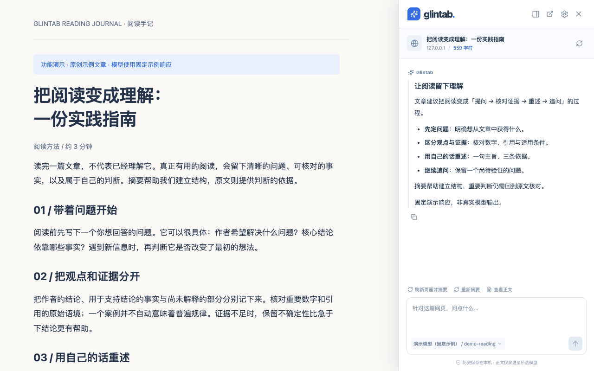
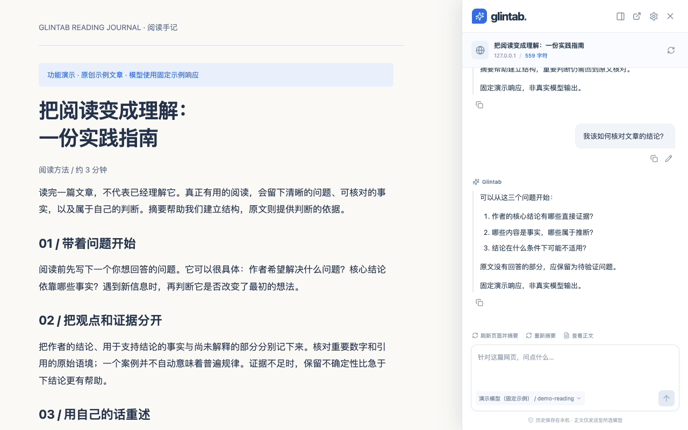
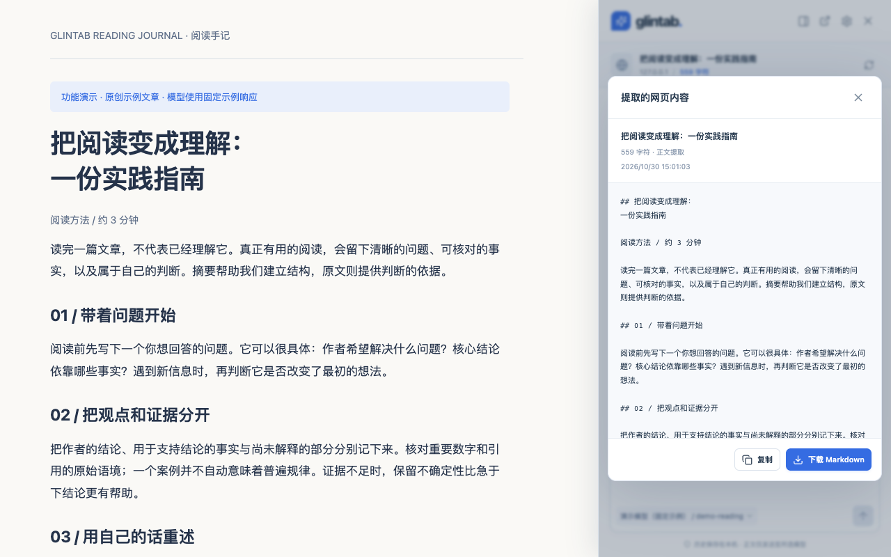
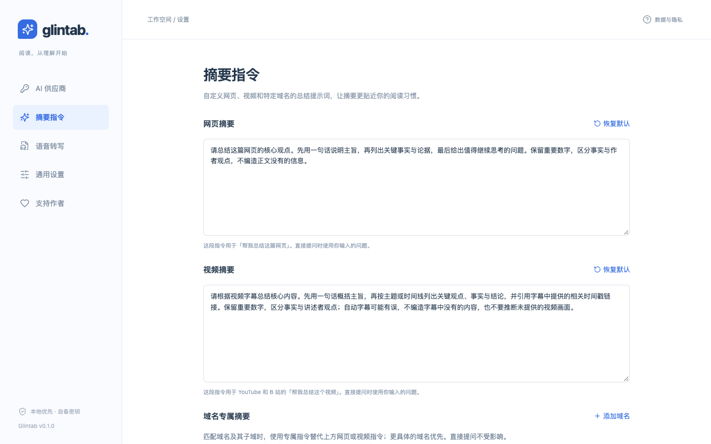
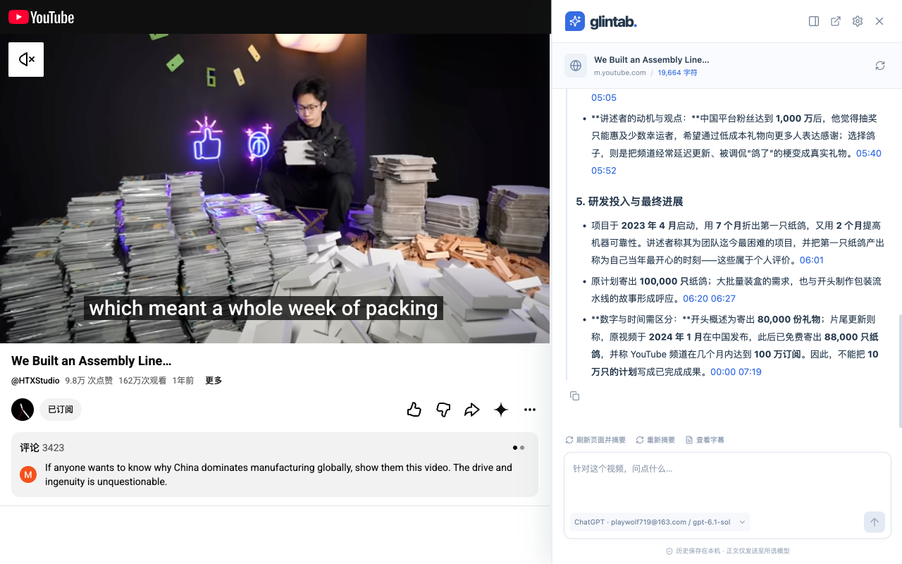

<div align="center">
  
  <h1>Glintab</h1>
  <p><strong>阅读，从理解开始。</strong></p>
  <p>用自己的 AI 模型，在网页旁提炼重点、核对原文、继续追问。</p>
  <p>中文优先 · 自选模型 · 本地保存</p>
  <p>
    <a href="#快速开始">快速开始</a> ·
    <a href="docs/USAGE.md">使用指南</a> ·
    <a href="docs/PRIVACY.md">隐私说明</a> ·
    <a href="https://github.com/playwolf719/glintab/issues">反馈问题</a> ·
    <a href="#支持作者">支持作者</a>
  </p>
</div>



<p align="center"><sub>实际扩展界面，使用原创示例文章与固定模型响应演示。</sub></p>

## 让阅读多走一步

读长文章时先抓住主线，遇到疑问就围绕原文追问，需要确认依据时再查看模型读到的内容。Glintab 将这些操作放在当前网页旁，让摘要成为深入阅读的起点。

| 你想做的事       | Glintab 提供的能力                                          |
| ---------------- | ----------------------------------------------------------- |
| 先理解一篇长文   | 一键摘要，也可以直接带着问题开始，多轮追问                  |
| 核对回答的依据   | 查看提取正文、长度与截断状态，复制或导出 Markdown           |
| 用习惯的模型     | 多供应商切换，支持 OpenAI 兼容协议、Anthropic 与本机 Ollama |
| 按自己的方式总结 | 分别设置网页、视频摘要指令，为特定域名定制提示词            |
| 阅读视频内容     | YouTube / B 站字幕提取、时间戳链接与追问；可选 B 站音轨转写 |
| 稍后继续阅读     | 最近 10 个网址的本地历史；关闭面板后，生成任务继续运行      |

支持网页抽屉、浏览器侧栏和独立窗口；可停止生成、复制回答，以及编辑最后一个问题重新发送。界面默认中文，回答语言可选中文、英文或跟随正文。

<details>
<summary>更多界面预览：追问、正文核对与摘要指令</summary>

**围绕原文继续追问**



**查看模型读到的正文，复制或下载 Markdown**



**为网页、视频和特定域名设置摘要指令**



以上截图均为演示环境，不代表真实模型或视频网站的适配验收。

</details>

## 视频也能边看边读

从字幕中梳理重点，通过回答中的时间戳回到视频对应位置，也可以围绕内容继续追问。B 站按当前分 P 处理。

**YouTube · 在视频旁查看摘要与时间戳**



**B 站 · 提炼视频重点，随时核对字幕**


## 快速开始

需要 **Chrome 116+**；从源码构建需要 **Node.js 22.12+**，推荐 Node.js 22 LTS。目前可通过开发者模式安装。

```bash
git clone https://github.com/playwolf719/glintab.git
cd glintab
npm ci
npm run build
```

1. 打开 `chrome://extensions`，启用「开发者模式」。
2. 点击「加载已解压的扩展程序」，选择项目中的 **`output/chrome-mv3`** 目录。
3. 打开扩展的「详细信息 → 扩展程序选项」，添加模型供应商，填写连接信息和模型，点击「保存并授权」。
4. 打开一篇普通网页，点击工具栏中的 Glintab 图标，选择「帮我总结这篇网页」，或直接输入问题。

如提示缺少网页读取权限，可选择「仅授权当前网站」，或自行选择「一次授权所有网站」。网页读取与模型服务的域名权限分别授权。

需要分发包时运行 `npm run zip`，产物在 `output/`；更新代码后重新构建，并在扩展管理页点击「重新加载」。完整步骤见 [安装与使用指南](docs/USAGE.md#安装使用)。

## 连接你自己的模型

Glintab 本身免费，需自备可用的模型服务或账号权限；模型与转写服务可能另行收费。

| 接入方式        | 说明                                                                            |
| --------------- | ------------------------------------------------------------------------------- |
| OpenAI 兼容服务 | 支持 Chat Completions 和 Responses，可自定义 Base URL、API Key 与模型           |
| Anthropic       | 支持 Messages 协议                                                              |
| Ollama          | 通过本机 OpenAI 兼容接口接入                                                    |
| ChatGPT 账号    | 提供 Codex 兼容授权连接，无需启动本机服务；实际可用性取决于账号、地区及平台接口 |

可配置流式输出和兼容模型的推理强度，也可导入支持的 Claude Code、Codex、OpenCode 或通用配置。Glintab 并非 OpenAI 官方扩展，ChatGPT 账号连接的真实联调状态见 [登录说明](docs/CHATGPT_LOGIN.md)。详细参数见 [模型配置](docs/USAGE.md#配置模型)。

## 数据保存在本机，发送由你发起

- **本地保存**：配置、会话和最近 10 个网址的正文保存在当前浏览器，可在设置中清除。
- **直接请求**：发起摘要或提问时，必要的标题、网址、正文、问题与历史直接发送到所选模型服务。Glintab 没有自建模型中转服务器、遥测、广告或云同步。
- **按需授权**：默认不授予全站读取权限；由你选择网页与服务域名的授权范围。
- **可选音轨转写**：启用 B 站无字幕转写后，相关音频上传到你配置的转写服务；原音频与带签名的音轨地址仅在内存中使用。

API Key 和账号令牌在扩展本地存储中**未加密**。发送到第三方服务的数据受对应服务的隐私政策约束。完整说明见 [隐私与权限](docs/PRIVACY.md)。

## 当前支持范围

普通网页以可提取的文本正文为基础；视频总结以字幕或转写文字为基础。自动字幕、转写和模型回答可能有误，重要信息请核对原文。

- **视频**：提供 YouTube 与 B 站字幕提取，B 站按当前分 P 处理。可用性受字幕、登录状态与平台接口影响；真实站点验证仍有限，详见 [验收记录](docs/ACCEPTANCE.md)。
- **B 站无字幕转写**：需单独启用并配置转写服务，仅支持 60 分钟以内、压缩音轨不超过 64 MB 的普通投稿视频；付费转写接口尚未使用真实密钥联调。
- **内容范围**：暂不支持 YouTube 音轨转写、视频画面理解、直播、B 站番剧或课程、合集批量总结、OCR 与通用 PDF 阅读。浏览器内置页、扩展商店等受限页面无法提取。
- **任务恢复**：关闭面板后继续生成；浏览器退出或扩展重载会中断任务，不能续传。长内容可能按上下文预算缩减，界面会提示。

## 参与开发

基于 **WXT / Manifest V3 / React / TypeScript**。入口协调浏览器上下文，提取、模型协议和任务引擎分层，持久化统一由后台 Repository 完成。

```bash
npm run dev          # 开发模式；手动加载 output/chrome-mv3-dev
npm run check        # 类型检查、行为测试、生产构建与产物校验
npm run test:e2e     # 跨上下文浏览器验收（首次需 npx playwright install chromium）
npm run test:e2e:dev # 隔离的开发模式验收
npm run format      # 统一格式
```

浏览器验收使用临时 Chromium 配置和本机模拟服务，不连接个人浏览器、不调用付费模型。开发服务需保持运行；其地址不是扩展主界面。

| 文档                                   | 内容                                           |
| -------------------------------------- | ---------------------------------------------- |
| [使用指南](docs/USAGE.md)              | 安装、模型配置、摘要指令、视频与转写、排障细节 |
| [架构与扩展指南](docs/ARCHITECTURE.md) | 模块边界、数据流、协议与提取器扩展             |
| [验收记录](docs/ACCEPTANCE.md)         | 自动化覆盖、真实平台验证状态与限制             |
| [迭代路线](docs/ROADMAP.md)            | 后续功能方向                                   |
| [发布材料](docs/release/README.md)     | 商店文案、审核说明与隐私申报                   |

欢迎通过 [Issues](https://github.com/playwolf719/glintab/issues) 提交问题与建议，也欢迎贡献改进。反馈时请附上复现步骤、浏览器版本与服务协议，并隐去密钥、账号凭证和敏感正文。

## 支持作者

如果 Glintab 对你有帮助，欢迎点个 Star，或请作者喝杯咖啡，支持项目持续维护。

使用微信扫描下方收款码，自愿选择金额；付款前请核对收款人信息。也可在扩展的「设置 → 支持作者」中查看或保存收款码。

<p align="center">
  <a href="assets/support-qr.jpg">
    
  </a>
</p>

<p align="center"><sub>微信扫码支持作者 · 点击图片查看原图</sub></p>

Glintab 免费使用，打赏完全自愿，不影响功能使用，也不解锁额外功能。付款在微信中完成，扩展不读取付款账号、金额或交易记录。

联系：[playwolf719@gmail.com](mailto:playwolf719@gmail.com)。
