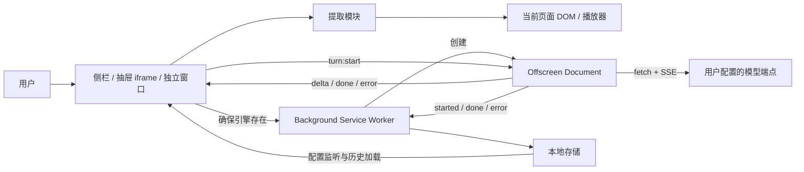

# 网页与视频 AI 对话浏览器插件：复刻与新项目开发规格

> **产品形态：Chrome 浏览器插件（Browser Extension，亦称浏览器扩展），基于 Manifest V3。**
>
> 基于当前 WebSideChat 仓库源码整理，供从零开发自己的浏览器插件、调整需求和交给 AI 编程工具实施使用。
>
> 整理日期：2026-10-29；参考版本：`0.1.3`；参考提交：`9f97b3d`。
>
> 文中的「现有行为」来自源码静态核对；「建议」属于新项目设计，不代表原项目已经实现。本文未进行浏览器运行验证，也未验证供应商及视频网站接口当前是否可用。

## 1. 如何使用这份文档

这是一份产品需求与技术实现合并的开发蓝图。新项目不需要读取原仓库，也应能据此实现主要功能；末尾的源码索引用于需要深入核对时定位实现。

推荐使用顺序：

1. 填写第 2 节的项目定制表，确定自己的产品定位和第一版范围。
2. 按第 3～6 节实现用户可见功能与页面交互。
3. 按第 7～12 节实现扩展架构、数据、内容提取和模型调用。
4. 按第 14 节分阶段开发，使用第 15 节验收。
5. 将第 17 节的启动指令连同本文交给 AI 编程工具。

**复用范围说明：**本仓库的 [LICENSE](../LICENSE) 和 [README_ZH.md](../README_ZH.md) 标注 CC BY-NC 4.0，要求署名并限制商业用途。本文不会改变原仓库许可；直接复用源码、图标或其他素材时，应保留并遵守相应许可。新项目的名称、品牌素材、代码及发布材料需要单独确定。

## 2. 新项目定制表

先修改本表；未修改项可按「建议初始选择」开发。

| 项目 | 建议初始选择 | 你的决定 |
| --- | --- | --- |
| 产品名称 / 包名 | 使用自己的品牌及唯一包名 | 待填写 |
| 产品形态 | 可安装到浏览器的插件（Browser Extension） | 待填写 |
| 产品定位 | 使用自备模型密钥的网页阅读助手 | 待填写 |
| 第一版浏览器 | Chrome，Manifest V3 | 待填写 |
| 目标用户 | 阅读长文、研究资料、学习视频的个人用户 | 待填写 |
| 第一版内容源 | 普通网页；视频功能后续加入 | 待填写 |
| 界面入口 | 网页右侧抽屉，原生侧栏兜底 | 待填写 |
| 模型接入 | 第一阶段 OpenAI Chat 兼容，随后补齐三种协议 | 待填写 |
| 密钥来源 | 用户手动配置 API Key | 待填写 |
| 数据存储 | 设备本地，无自建服务端 | 待填写 |
| 会话隔离 | 按网址保存历史，按标签页隔离运行任务 | 待填写 |
| 界面风格 | 紧凑、内容优先，替换主色、图标和品牌 | 待填写 |
| 语言 | 中文优先，保留英文扩展能力 | 待填写 |
| 核心差异点 | 选择一个：引用定位 / 学习笔记 / 研究摘要 / 翻译 | 待填写 |
| 暂不实现 | 账号体系、付费、云同步、知识库、多模态 | 待填写 |

如果目标是完整复刻，则保留本文列出的所有现有功能；如果目标是尽快推出自己的版本，可按第 14 节逐步增加功能。

## 3. 产品定义与边界

### 3.1 一句话定义

一款基于 Chrome Manifest V3 的浏览器插件：用户安装后，通过浏览器工具栏图标，在当前网页或受支持的视频页打开侧栏，使用自己配置的 AI 模型生成摘要，并围绕提取内容进行连续问答。本文中的「浏览器插件」与「浏览器扩展」均指 Browser Extension。

**插件的交付与运行方式：**

- **安装：**开发阶段在 `chrome://extensions` 加载构建后的插件目录；分发时提供插件包，或通过浏览器扩展商店安装。
- **入口：**浏览器工具栏中的插件图标；主要界面是当前网页右侧的抽屉或浏览器原生侧栏，也可以弹出独立窗口。
- **运行：**由浏览器加载 Manifest、后台 Service Worker、内容脚本和插件页面；设置页和对话界面使用 React 实现。
- **页面访问：**通过内容脚本和浏览器扩展 API，在获得权限后读取当前网页正文或播放器字幕。
- **数据与请求：**配置和会话存入浏览器插件存储，模型请求由插件直接发送至用户配置的服务端点。
- **最终交付物：**包含 `manifest.json`、脚本、页面、样式和图标的可加载目录，以及供分发的 zip 包。

### 3.2 核心价值

- 不离开当前网页即可理解主要内容、提问和查看回答。
- 同一份提取内容作为后续问答的常驻上下文，减少重复操作。
- 用户可以选择不同模型服务，并导入已有工具配置。
- 视频摘要包含时间戳，可点击定位到播放器中的对应位置。
- 各页面的生成任务可并行执行，关闭侧栏不会主动取消生成。

### 3.3 当前项目已覆盖的功能

| 模块 | 现有能力 |
| --- | --- |
| 浏览器入口 | 工具栏按钮、网页内抽屉、原生侧栏、独立弹窗 |
| 内容提取 | 网页正文转 Markdown；YouTube 和 B 站字幕提取 |
| 对话 | 快捷摘要、首轮直接提问、多轮追问、流式输出、停止 |
| 消息操作 | 复制消息、编辑最后一条用户问题并重发 |
| 内容查看 | 查看截断后的提取正文、复制、下载 `.md` |
| 模型供应商 | 新增、编辑、删除、切换、预设、获取模型列表 |
| 协议 | OpenAI Chat Completions、Anthropic Messages、OpenAI Responses |
| 配置导入 | Claude Code JSON、Codex JSON/TOML、OpenCode JSON、通用 JSON |
| 账号接入 | 包含 ChatGPT OAuth 登录尝试及令牌导入路径 |
| 个性化 | 网页与视频摘要指令分别自定义；中英文界面与输出语言 |
| 上下文 | 提取长度预算、历史压缩、正文缩减、会话数量限制 |
| 持久化 | 本地供应商配置、会话历史、设置；会话级抽屉状态 |

### 3.4 第一版不要隐含承诺的能力

- 视频理解来自字幕，没有音频转写、画面分析或无字幕视频识别。
- YouTube 的专用提取路径只识别 `/watch`；Shorts 不走视频字幕逻辑。
- B 站专用路径识别 `/video/`，当前优先并限定选择中文字幕。
- 不具备通用 PDF、图片 OCR、跨网页搜索或知识库检索能力。
- 没有账号体系、支付、云端同步、团队协作或自建模型代理服务。
- 没有完整的会话历史管理页面、对话批量导出或清空全部数据界面。
- 提供深色样式变量，但未看到完整的主题选择及自动跟随系统逻辑。
- 「减少观看时间」来自直接阅读摘要，不等于移除视频网站广告。

## 4. 用户流程

### 4.1 首次配置

1. 用户安装扩展，打开普通网页，点击工具栏图标。
2. 右侧显示抽屉；尚未配置模型时，展示「添加 AI 供应商」入口。
3. 点击进入设置新标签页，选择配置类型或服务商预设。
4. 手动填写名称、协议、Base URL、API Key、模型及可选上下文上限，或粘贴配置文件内容。
5. 保存时申请该模型域名的访问权限；拒绝时显示明确提示。
6. 第一条保存成功的供应商自动设为当前供应商。
7. 返回网页侧栏后，供应商配置通过存储监听自动更新。

### 4.2 一键摘要

1. 用户点击「帮我总结网页内容」或「帮我总结视频内容」。
2. 提取正文或字幕，按模型预算截断，保存新会话。
3. 选择网页或视频摘要指令，创建摘要回合。
4. 后台开始请求，侧栏逐步渲染回答。
5. 保存最终结果，用户继续追问。

摘要指令作为首条 user 消息参与请求，但默认不作为聊天气泡展示。摘要结果直接作为第一条助手消息展示。

### 4.3 首轮直接提问

用户可以跳过快捷摘要，在空会话中直接输入问题。扩展先提取当前内容，再带着用户问题生成回答；不额外插入一轮自动摘要。

### 4.4 多轮追问与编辑

- 已提取内容复用于后续请求，不在每次追问时重新抓取网页。
- 点击最后一条用户问题的编辑按钮，原文回填到底部输入框。
- 重新发送后，从被编辑问题的位置截断历史，再开始新一轮回答。
- 其他消息可以复制；视频消息复制时，时间戳占位应展开为可用链接。

### 4.5 切页、关闭侧栏和弹出窗口

- 切换到不同网址时加载对应的本地会话。
- 页面 A 生成中切换到页面 B，不主动停止 A 的任务；B 可以另起任务。
- 关闭或收起侧栏后，后台任务继续执行，结果由后台写入本地存储。
- 独立弹窗默认 `440 × 720`，携带来源 `tabId`，固定跟踪来源标签页。
- 打开弹窗后收起来源网页抽屉；原生侧栏关闭失败时保留，由用户手动关闭。

**现有隔离语义：**会话和生成控制器的键是 `pageKey`，即规范化 URL，并非 `tabId`。两个标签页打开相同规范化网址时会共享历史，也会竞争同一生成任务。新项目若需要严格按标签页隔离，必须同时修改数据键和任务键。

### 4.6 重新提取与重新摘要

| 动作 | 内容来源 | 历史处理 | 当前确认行为 |
| --- | --- | --- | --- |
| 首次摘要 | 当前网页或字幕 | 建立新会话 | 无确认 |
| 重新提取 | 重新抓取当前内容 | 清空旧消息，随后生成摘要 | 直接执行 |
| 重新摘要 | 已缓存的正文 | 已有回答时清空旧消息，再生成 | 已有额外追问时确认 |
| 停止 | 当前进行中任务 | 保留已生成的部分或补占位回复 | 无确认 |

## 5. 页面与交互规格

### 5.1 主对话侧栏

从上到下分为四层：

```text
┌────────────────────────────────────┐
│ 当前供应商 ▼        弹出 固定 设置 关闭 │
├────────────────────────────────────┤
│ 页面标题 / 域名   已提取 N 字符  刷新 │
├────────────────────────────────────┤
│ 错误提示 / 本站授权提示（按需显示）    │
│                                    │
│ 快捷摘要入口，或已保存的聊天消息        │
│ 助手 Markdown 回答与流式文本          │
│ 用户消息：右对齐                     │
│                                    │
├────────────────────────────────────┤
│ 问题输入框                    发送/停止 │
└────────────────────────────────────┘
```

| 区域 | 交互要求 |
| --- | --- |
| 供应商下拉 | 显示供应商图标与名称，勾选当前项，底部提供管理入口 |
| 顶部操作 | 弹出独立窗口；固定新标签页自动展开；设置；抽屉模式可关闭 |
| 页面信息条 | 标题、域名、提取字符数、截断状态、重新提取按钮 |
| 空状态 | 无供应商显示配置入口；有供应商无消息显示快捷摘要 |
| 输入框 | Enter 发送，Shift+Enter 换行，中文输入法组合输入时不误发送 |
| 生成中 | 显示流式助手消息、加载状态、停止按钮；防止同页重复发送 |
| 滚动 | 距底部小于 60px 时跟随新输出；用户向上阅读时不拉回底部 |
| 消息操作 | 悬停显示复制，最后一条用户消息额外显示编辑 |
| 错误 | 显示可关闭错误条；权限问题提供站点授权按钮 |

### 5.2 提取内容弹窗

默认启用内容查看入口。点击字符数展示：标题、字符数、是否截断、提取时间，以及正文原始文本。

- 正文为等宽字体，允许滚动和自动换行。
- 提供复制、下载 Markdown、关闭三个操作。
- 展示的是会话中保存的正文，不是完整 HTTP 请求，也不包含所有提示词和历史。

### 5.3 设置页

设置页独立打开，默认进入供应商管理。左侧导航三项：AI 供应商、提示词、通用设置。参考布局：左栏 `176px`，右侧内边距 `24px`，主体最大宽度约 `768px`。

供应商管理包含三个视图：

1. **列表：**供应商名称、模型、当前状态；使用、编辑、删除操作；新增入口；内容查看开关。
2. **预设选择：**Claude Code、Codex、OpenCode 三种配置类型，以及手动服务商预设。
3. **配置表单：**名称、API 协议、Base URL、API Key、模型、上下文上限；配置导入；获取模型；保存和取消。

其他行为：

- 删除供应商前确认；删除当前项后选择最早创建的剩余项，无剩余项则清空当前选择。
- API Key 默认遮罩，可切换显示。
- 配置文本错误展示提示及错误样式；保存前再次解析，覆盖「粘贴后直接保存」场景。
- `?add=1` 可直达新增，`?edit=<id>` 可直达编辑。
- 旧配置缺域名权限时，列表展示一键补授权入口。

提示词页包含网页、视频两个摘要指令编辑区，分别支持恢复默认，统一保存。现有系统角色提示词固定；类型中残留的自定义 system 字段不参与运行时覆盖。

通用设置包含界面语言和摘要/回答语言：界面中文或英文；输出中文、英文或跟随正文语言。未设置时默认按浏览器语言选择中文或英文。

### 5.4 视觉参考

- 现有界面以白底、黑灰文字、细边框、小圆角为主，使用系统字体。
- 对话主文字约 `14px`，辅助文案约 `11–12px`。
- 默认抽屉宽度 `400px`；左侧边缘可拖拽，双击恢复默认。
- 拖拽代码目标范围为最小 `280px`、最大 `760px`，并尽量给原网页留 `160px`。
- 抽屉覆盖在页面右侧，不通过修改正文宽度挤压原站布局；滑入过渡约 `220ms`。
- 用户消息是右侧浅灰气泡，助手内容在左侧边框容器中，以 Markdown 排版。
- 新项目可替换颜色、字体和布局，但应保留清晰的页面来源、提取状态和生成状态。

仓库截图可供对照：[网页](zh-web-preview.png)、[YouTube](zh-youtube-preview.png)、[B 站](zh-bilibili-preview.png)。截图为既有展示材料；具体行为以当前源码为准。

## 6. 状态与错误处理

建议新项目显式维护以下状态；原实现使用多个 React 状态组合表达：

```text
未配置模型 → 可操作空会话 → 提取中 → 请求启动中 → 流式生成 → 已完成
                    ↑           ↓           ↓          ↓
                    └──── 授权 / 失败 / 用户停止 ←──────┘
```

| 情况 | 应展示与允许的操作 |
| --- | --- |
| 无当前页面 | 提示没有可处理页面，禁用发送 |
| 无模型配置 | 引导新增供应商 |
| 无页面注入权限 | 展示站点名与授权按钮，授权成功后重试 |
| 受限制页面 | 侧栏可打开不代表内容可提取，显示不可访问原因 |
| 无正文或字幕 | 明确说明无法提取，不伪造摘要 |
| YouTube 字幕未开启 | 提示用户先开启并选择字幕 |
| B 站无中文字幕 | 说明当前不支持该视频字幕；可能需要用户登录 |
| 401 / 403 | 提示密钥、鉴权或访问配置问题 |
| 429 | 提示限流或配额问题 |
| 404 | 提示 Base URL、路径或模型端点不匹配 |
| 网络中断 | 保留部分生成文本，附中断说明 |
| HTTP 200 但无正文 | 作为空响应错误处理，允许用户重试 |
| 用户停止 | 终止当前任务，已有部分文本保留；无文本时补占位 |
| 引擎未启动 | 结束加载状态，提示重新尝试，避免无限转圈 |

现有权限错误自动重试会回到默认摘要路径；如果最初是在直接提问流程中失败，问题文本没有完整保留。新项目应保留待重试动作及原问题。

## 7. 技术栈与模块结构

### 7.1 参考技术栈

以下是当前依赖声明，作为可复现的技术选型参考，不表示必须采用同一版本：

| 层 | 当前选择 |
| --- | --- |
| 扩展工程 | WXT `^0.21.3`，Chrome Manifest V3 |
| UI | React / React DOM `^19.2.4`，TypeScript `^5.9.3` |
| 样式 | Tailwind CSS `^4.1.14`，Radix UI，Lucide 图标 |
| 表单 | React Hook Form、Zod、zodResolver |
| 网页正文 | Mozilla Readability `^0.6.0` |
| HTML 转文本 | Turndown `^7.2.4` 与 GFM 插件 |
| Markdown 显示 | react-markdown `^10.1.0`、remark-gfm |
| 配置格式 | 原生 JSON、smol-toml |
| 网络 | fetch、ReadableStream、自定义 SSE 解析器 |
| 存储 | WXT storage 封装的浏览器 local / session 存储 |
| 测试与发布 | Vitest、部分 jsdom 测试、GitHub Actions |

### 7.2 建议目录

```text
entrypoints/
  background.ts             # 扩展事件、权限相关协调、创建引擎、持久化
  drawer.content.ts         # 网页抽屉宿主、iframe、拖拽、播放器定位
  extract.content.ts        # 普通网页正文提取，按需注入
  offscreen/                # 长时对话任务引擎
  sidepanel/                # 抽屉、原生侧栏、独立窗口共用的 React 应用
  options/                  # 独立设置页
components/
  chat/                     # 消息、输入框、流式状态
  providers/                # 供应商管理、表单、导入
  settings/                 # 通用设置、提示词
  ui/                       # 基础组件
lib/
  llm/                      # 三种协议适配器、SSE、模型列表
  video/                    # 视频站提取及时间戳逻辑
  storage.ts                # 持久化仓储
  conversation.ts           # 会话变换与保留策略
  context.ts                # token 估算与预算
  prompts.ts                # 系统提示词与摘要指令
  importConfig.ts           # 配置解析与字段映射
  permissions.ts            # 运行时域名授权
  i18n.ts                   # 界面语言
types/                      # 共享类型与消息协议
config/                     # 服务商和配置类型预设
tests/                      # 纯函数、协议与会话测试
```

### 7.3 上下文职责分工



- **UI：**收集动作、发起提取、乐观显示问题、订阅回合事件。
- **Content Script：**接触网页 DOM，创建抽屉或完成提取；播放器内部状态读取使用 `world: 'MAIN'` 注入。
- **Background：**处理工具栏和标签页生命周期；创建/关闭 offscreen；集中接收会话持久化事件。
- **Offscreen：**拼装上下文、压缩历史、发起 LLM 网络请求、广播流式结果。

采用独立引擎宿主，是为了让网络请求不随 React 页面卸载而主动中止，同时避免单纯依赖 Service Worker 的空闲生命周期。浏览器退出、扩展重载等仍可能终止任务，不承诺绝对常驻。

## 8. 数据模型与存储

### 8.1 核心类型

以下是可供新项目直接使用的精简模型；品牌字段及导入原文可按需求增减。

```ts
type ApiFormat = 'openai_chat' | 'anthropic' | 'openai_responses';
type Language = 'zh' | 'en' | 'auto';

interface Provider {
  id: string;
  name: string;
  baseUrl: string;
  apiKey: string;
  model: string;
  apiFormat: ApiFormat;
  contextLimit?: number;
  accountId?: string;
  importHint?: 'claude-settings' | 'codex' | 'opencode-json';
  importTexts?: Record<string, string>;
  icon?: string;
  createdAt: number;
}

interface ChatMessage {
  role: 'user' | 'assistant';
  content: string;
}

interface Conversation {
  pageKey: string;
  url: string;
  title: string;
  content: string;
  truncated: boolean;
  extractedAt: number;
  messages: ChatMessage[];
  summaryPrompt?: string;
  updatedAt: number;
}

interface AppSettings {
  uiLang?: 'zh' | 'en';
  summaryLanguage?: Language;
  debugMode?: boolean;
  customWebSummaryPrompt?: string;
  customVideoSummaryPrompt?: string;
}

interface ExtractResult {
  title: string;
  byline?: string;
  siteName?: string;
  textContent: string;
  length: number;
  fallback: boolean;
  format: 'markdown' | 'plaintext';
  error?: string;
}
```

### 8.2 存储项

| 存储 | 键 | 内容 / 默认值 |
| --- | --- | --- |
| local | `providers` | `Record<id, Provider>` / `{}` |
| local | `currentProviderId` | 当前供应商 ID / `null` |
| local | `settings` | 设置；`debugMode` 默认 `true` |
| local | `conversations` | `Record<pageKey, Conversation>` / `{}` |
| local | `drawerWidth` | 抽屉宽度 / `400` |
| session | `drawerPinned` | 新标签页自动展开开关 / `false` |
| session | `drawerOpen:<tabId>` | 每个标签页的抽屉显示状态 / `false` |
| session | `panelDisabled` | 原生侧栏禁用状态 |
| session | `lastPanelTabId` | 最近打开原生面板的来源标签页 |

现有 API Key 和导入原文均保存在本地扩展存储，没有加密层。导入原文可能额外含 access token、refresh token；新项目应决定是否需要保存这些原文，而不是默认全部持久化。

### 8.3 页面键与保留规则

`pageKey` 的现有计算规则：去首尾空白、去 hash，删除以 `utm_`、`spm`、`from`、`vd_source`、`ref_` 开头或恰为 `ref` 的查询参数，保留其他参数。非法 URL 退回原字符串。

- 最多保存 10 个页面会话，按 `updatedAt` 淘汰较旧项。
- 不是按最近打开时间淘汰：仅打开旧会话并不会自动更新 `updatedAt`。
- 单会话消息最多 100 条；当前实际代码直接保留最后 100 条，并没有特殊保护首轮摘要。
- query 参数不排序，因此参数排列不同的 URL 仍可能形成不同键。
- 去 hash 不适合所有单页应用；对于 hash 路由，新项目应提供站点级规范化策略。

现有会话写入使用模块内 Promise 链串行读改写，只能串行化同一运行上下文中的调用。新项目建议所有会话写入统一经 background 完成；更大数据量可改用 IndexedDB，避免多窗口读改写覆盖和存储配额问题。

## 9. 内容提取实现

### 9.1 普通网页

算法顺序：

1. 按需注入提取脚本，不将正文提取设为全站持续抓取。
2. 克隆完整 DOM，避免 Readability 修改真实页面。
3. 用 Readability 获取正文、标题、作者、站点信息。
4. 将正文 HTML 转 Markdown；结果不足 40 字符时，清洗整页后再次转换。
5. 仍不足 40 字符时，退回 `document.body.innerText`。
6. 按模型的正文字符预算截断，生成会话。

转换规则：保留标题、段落、列表、引用、代码和 GFM 表格；移除 script、style、iframe、svg 等噪声节点；相对链接转绝对链接；纯锚点链接只留文字；图片只保留 alt 描述占位，不向模型发送图片。

建议新增有效正文为空的判断。当前提取调度主要检查返回字段类型，并不能保证最终文本非空。工具页、登录页和动态网页可能落入整页兜底，带入导航或其他无关内容，应保留提取内容查看能力。

### 9.2 YouTube

现有实现路线：

1. 识别 YouTube `/watch` 页面。
2. 使用 MAIN world 注入读取 `movie_player` 的实时响应、字幕轨道和用户选中的轨道，等待播放器就绪。
3. 用户没有开启字幕时提示开启；自动翻译目标语言也参与读取。
4. 临时包装页面 fetch 和 XHR，触发字幕轨道重新加载，捕获播放器自己的 `/api/timedtext` 请求及响应。
5. 优先解析捕获响应；其次重放捕获到的请求 URL。
6. 支持 json3 和 transcript XML，转换为带 `[HH:MM:SS]` 的逐行文本。
7. 在 finally 中恢复 fetch / XHR，尽量恢复原字幕选择。

该路径依赖播放器内部结构、接口与当前登录/字幕状态。不是直接拿公开字幕 URL 就一定可用；新项目应把站点适配封装为可单独维护的模块，并保留超时、恢复和失败提示。

### 9.3 B 站

现有实现路线：

1. 识别 `/video/`，从页面状态读取 `aid`、`cid`、标题、UP 主和分 P 信息。
2. 临时包装 fetch / XHR，触发中文字幕菜单项，捕获字幕 CDN JSON。
3. 手动中文字幕优先于 AI 中文字幕；尽量恢复原字幕开关及轨道。
4. 捕获失败时，获取 WBI 签名所需信息，本地计算签名，尝试字幕列表接口；另有无签名接口兜底。
5. 请求选中的字幕 JSON，将 `body[].from/content` 转成带时间戳文本。

该实现包含短暂隐藏字幕与切换提示的逻辑。新项目应减少对页面的可见影响，并确保异常时也恢复临时样式、观察器和网络钩子。中文字幕不可用时返回错误；不自动改用其他语言或音频识别。

### 9.4 视频时间戳

模型生成简短占位链接：`[05:30](#t)`；超过一小时可用 `[01:05:30](#t)`。渲染时解析时间文本，展开为站点完整 URL：

- YouTube：`https://www.youtube.com/watch?v=<id>&t=330s`。
- B 站：`https://www.bilibili.com/video/<id>?t=330`；保留必要的分 P 参数。

点击时优先对当前来源视频设置 `currentTime` 并播放。抽屉通过 iframe 的 postMessage 通知 content script；原生侧栏和独立窗口通过来源 tab 注入脚本。注入失败时可降级打开链接。

建议仅拦截确实指向当前视频的时间戳，避免把回答引用的其他视频错误定位到当前播放器。

## 10. 提示词与上下文策略

### 10.1 每轮请求组成

```text
system = 固定角色 + 输出语言指令 + <page>
         URL、标题、截断提示、缓存正文或字幕
         </page>
messages = 已有 user/assistant 历史 + 本轮问题
```

正文放在 system 上下文中，摘要轮与追问轮共用。网页角色要求基于提供内容回答；视频角色额外要求按指定占位格式引用时间戳。

建议新项目明确将网页正文视为待分析资料，区分用户指令与资料内的指令，减少网页内容对模型行为的干扰。

### 10.2 默认摘要输出

网页：一句话总结、3～6 条核心要点、关键数据或结论。视频：一句话总结、3～6 条附时间戳要点、关键结论。信息不足时如实说明；具体措辞与章节名称可替换成自己的产品风格。

自定义摘要指令优先于语言对应的内置默认。界面语言与回答语言独立；「跟随正文」由语言指令表达，不是额外的文本翻译服务。

### 10.3 预算公式

当前实际值以 `lib/utils.ts`、`lib/context.ts` 为准：

```text
上下文上限 = 显式 contextLimit
             或模型名长度后缀（例如 [128k]、[1m]）
             或默认 1,000,000 token

正文预算字符 = clamp(floor(上下文上限 × 0.8 × 1.7), 4,000, 1,000,000)
文本 token 估算 = ceil(字符数 / 1.7)
总 token 估算 = system 估算 + 各消息估算 + 每条消息 4 token 开销
压缩阈值 = 上下文上限 − 4,096 输出预留 − 1,024 安全余量
```

例：128,000 token 上下文的正文预算为 174,080 字符。模型名中的长度后缀只用于预算，发送 API 请求前必须移除。配置表单接受留空，或 8,000～10,000,000 的上下文上限，支持把 `128k`、`1m` 转为数字。

默认 100 万是当前代码的假设，不表示所有模型都支持。新项目建议使用服务商/模型元信息或要求用户明确设置；token 估算也只是近似，不能保证请求必定不超限。

### 10.4 压缩流程

1. 开始请求前估算总长度。
2. 超过阈值且已有足够历史时，调用同一供应商模型生成历史纪要。
3. 用「压缩标记 user 消息 + 纪要 assistant 消息 + 本轮问题」替换旧历史。
4. 仍超限或压缩失败时，将正文按 60% 反复缩短，标记 `truncated`。
5. 缩减循环在正文不大于 8,000 字符时不再继续；当前实现没有保证此时总请求一定达标。

新项目建议增加最终预算校验；明确压缩会额外消耗一次模型请求，并通过 UI 展示「上文已压缩」。必要时按完整问答轮次裁剪，避免破坏角色顺序。

## 11. 模型调用与配置导入

### 11.1 统一适配器

```ts
interface ProtocolAdapter {
  buildRequest(provider: Provider, request: {
    system: string;
    messages: ChatMessage[];
    maxTokens?: number;
    temperature?: number;
  }): {
    url: string;
    headers: Record<string, string>;
    body: unknown;
  };
  extractDelta(event: { event?: string; data: string }): {
    text?: string;
    done?: boolean;
    error?: { kind: string; message: string };
  } | null;
  extractFull(json: unknown): string | null;
}
```

| 协议 | 端点拼接 | 主要请求映射 | 主要增量 / 结束 |
| --- | --- | --- | --- |
| OpenAI Chat | `{baseUrl}/chat/completions` | system 放进 messages，Bearer 鉴权 | `choices[0].delta.content`；`[DONE]` 或 finish_reason |
| Anthropic | `{baseUrl}/v1/messages` | 顶层 system、messages、max_tokens；x-api-key | `content_block_delta` 的 text_delta；message_stop |
| OpenAI Responses | `{baseUrl}/responses` | instructions、input、stream；Bearer 鉴权 | `response.output_text.delta`；response.completed |

Base URL 只去尾斜杠，不自动补 `/v1`。因此 Chat / Responses 通常由用户在 Base URL 中提供版本段；Anthropic 适配器固定加 `/v1/messages`，需要避免重复版本段。

现有引擎每次显式传 `maxTokens=4096`，包括 Anthropic 路径；不能依据该适配器的默认参数注释认为实际输出上限为 16384。Responses 和 Anthropic 还带有固定的 effort 等参数，新项目建议按端点能力配置，避免把特定供应商参数强加给所有兼容接口。

### 11.2 SSE 与网络处理

- 使用 fetch POST 携带鉴权，不使用无法直接添加所需鉴权头的 EventSource。
- 用 TextDecoder 增量解码；按空行拆事件，支持跨 chunk、CRLF、多行 data、event 类型、注释和末尾 flush。
- 适配器仅提取可显示回答文本，跳过当前不展示的 reasoning/thinking 块。
- 服务端忽略 stream 返回完整 JSON 时，用 `extractFull` 兜底。
- Content-Type 为空时，当前代码尝试按 SSE 读取。
- 用 AbortController 取消；统一将鉴权、限流、HTTP、网络、解析、供应商错误映射成可读文案。
- 当前流式事件广播的是累计全文，简单但长回答开销较高；新项目可采用增量事件和受控频率快照。

### 11.3 服务商预设与模型列表

预设只是填写模板，不是独立后端适配代码。当前包括自定义、DeepSeek、Kimi、Kimi Anthropic 兼容、通义千问、智谱、Ollama，以及 Claude Code / Codex / OpenCode 配置类型。

获取模型时，Chat / Responses 使用 `{baseUrl}/models`，Anthropic 使用 `{baseUrl}/v1/models`；解析 `data[].id` 或 `models[].slug`。获取失败时保留手动输入模型能力。

当前对 Base URL 含 `chatgpt.com` 的情况返回硬编码模型列表，不能当成从服务器实时验证过的模型能力。预设模型名也只是本次源码快照中的默认值，新项目应允许更新。

### 11.4 配置导入映射

| 格式 | 主要提取字段 | 规则 |
| --- | --- | --- |
| Claude Code settings JSON | env 中 Base URL、AUTH_TOKEN/API_KEY、MODEL | AUTH_TOKEN 优先；显式模型优先，再回退默认模型字段；映射 Anthropic |
| Codex auth JSON | OPENAI_API_KEY，或 tokens.access_token/account_id | API Key 与 OAuth 令牌分别处理；OAuth 路径映射 Responses 与对应后端 |
| Codex config TOML | model、model_provider、model_providers 中 base_url/wire_api/内嵌 token | 活动 provider 优先，否则首个；wire_api=responses 时用 Responses |
| OpenCode JSON | 顶层 model、provider、npm、options、models.limit.context | 按 model 前缀选 provider；anthropic SDK 映射 Anthropic，指定 OpenAI SDK 映射 Responses，其余 Chat |
| 通用 JSON | baseUrl/baseURL、apiKey/api_key、model、apiFormat | 只填充可识别字段；当前通用解析没有完整接受 Responses 枚举 |

多输入框按顺序解析，后者提供的非空字段覆盖前者；单框失败收集错误，不阻止其他框解析。支持配置文本失焦后填充表单，以及表单修改后反向更新配置文本。

这些导入来自用户粘贴，不是扩展直接读取本机隐藏目录。第一版可仅支持单向导入；若实现双向同步，需要保护未知字段和密钥，并避免因模型编辑丢失原配置中的 context 等元数据。

### 11.5 OAuth 的范围

当前仓库包含 PKCE 登录流程：打开授权标签页、校验 state、轮询读取回调 URL、用 code/verifier 换令牌、将令牌映射到供应商配置。该代码包含特定客户端标识、回调地址和后端路径。

这部分只作为现有实现说明，不是对外部账号流程兼容性或当前可用性的保证。代码没有完整的自动令牌刷新实现。新项目建议先用 API Key 跑通核心链路，再按目标平台支持的集成方式单独设计账号登录和令牌生命周期。

## 12. 回合引擎与消息协议

### 12.1 现有消息

| 消息 | 方向与用途 | 主要字段 |
| --- | --- | --- |
| `offscreen:ensure` | UI → background，确保引擎存在 | type |
| `turn:start` | UI → offscreen，开始摘要或问答 | streamId、pageKey、provider、settings、conversation、userContent、target |
| `turn:started` | offscreen → UI/background，保存待回答问题 | streamId、pageKey、conversation |
| `turn:delta` | offscreen → UI，更新生成文本 | streamId、pageKey、full |
| `turn:done` | offscreen → UI/background，保存完成结果 | streamId、pageKey、conversation |
| `turn:error` | offscreen → UI/background，保存部分内容或占位 | streamId、pageKey、error、conversation |
| `turn:cancel` | UI → offscreen，取消当前页 | pageKey |
| `offscreen:idle` | offscreen → background，请求关闭空闲宿主 | type |

抽屉另有 `drawer:hello/get-state/set-open/toggle` 协议；iframe 到页面宿主通过带命名空间的 postMessage 发 close 和 seek。

### 12.2 启动与持久化

1. UI 乐观追加本轮问题，设置生成状态。
2. 请求 background 幂等创建 offscreen；多个同时创建请求复用同一 Promise。
3. UI 发送 `turn:start` 并等待确认，当前最多尝试 20 次、间隔 300ms。
4. offscreen 追加问题并发出 started，background 持久化。
5. 执行预算检查、历史压缩和流式请求；每次增量广播。
6. 成功、失败或取消均发出终态，由 background 保存结果。
7. 所有任务结束后空闲 2 分钟，通知 background 关闭 offscreen。

offscreen 不直接使用存储 API；所有持久化经 background 或其他有权限的扩展上下文执行。

### 12.3 新项目建议补齐的可靠性

- 以 `streamId` 对启动请求去重，保证重试不会重复调用模型。
- 每个事件同时校验会话键与当前任务 ID，忽略旧任务迟到结果。
- 取消和清理时校验控制器身份，避免旧任务 finally 删除新任务的控制器。
- 增加 `getTaskSnapshot` / `listActiveTasks` 协议，重开 UI 时主动获取真实状态及累计文本。
- 当前重开面板主要依据「末条是 user 且更新时间小于 2 分钟」猜测生成中；这不能替代可靠恢复，也不是完整的请求超时机制。
- UI 发起提取后，异步返回前检查来源页面是否仍匹配，避免慢提取覆盖切页后的视图。
- 持久化完成可有回执，存储失败给出可恢复提示；写入尽量由同一上下文统一处理。

## 13. 浏览器权限与抽屉实现

### 13.1 参考权限

当前显式权限：`storage`、`scripting`、`offscreen`、`activeTab`、`tabs`。WXT 根据 sidepanel 入口生成侧栏相关配置。

- 固定 host 权限覆盖 YouTube、B 站及字幕 CDN 域名。
- `optional_host_permissions` 声明 `<all_urls>`，运行时按模型域名或当前网站申请。
- 开启跨站自动展开时请求全站权限；用户拒绝则保持关闭。
- sidepanel HTML、脚本 chunk、样式等声明为网页可访问资源，供 iframe 加载。

申请权限和打开原生面板要保留用户点击上下文。新项目应根据选择的功能声明权限，不必照搬全量列表；例如只做手动打开时不一定需要全站自动展开的授权路径。

### 13.2 抽屉宿主

1. 在普通 HTTP(S) 网页创建唯一宿主节点及 closed Shadow DOM，隔离站点样式。
2. 使用固定定位的右侧抽屉，内部嵌入扩展 sidepanel iframe。
3. 首次展开才加载 iframe；关闭后保留实例，避免重复初始化。
4. 通过 session 存储跟踪各 tab 的开关，通过 local 存储记住全局宽度。
5. 工具栏点击优先切换抽屉；旧页面未注入时尝试按需注入。
6. chrome://、商店等不可注入页面改开原生侧栏，但正文提取仍可能不可用。
7. 标签页关闭后移除状态；扩展上下文失效后清理网页内的旧宿主。

需要测试窄窗口下宽度上下限关系，以及同一 tab 导航后是否恢复。postMessage 接收端应严格校验来源 iframe、可接受 origin、消息结构和动作参数。

### 13.3 隐私与发布材料

原架构无自建服务端：模型请求从扩展直接发往用户配置的端点，包含页面正文或字幕、页面元数据、用户问题和需要的历史。新项目若增加代理、账号、遥测、同步或云存储，应相应修改数据流说明和隐私政策。

发布材料应与实际实现一致。例如当前隐私文档提到设置页可清除全部数据，但当前 UI 没有看到对应完整入口；复刻时应补齐入口或改写说明。

## 14. 开发阶段与交付物

| 阶段 | 实施范围 | 完成标准 |
| --- | --- | --- |
| A：最小闭环 | 扩展骨架、原生侧栏、一个手动供应商、普通网页提取、摘要与提问 | 可安装本地扩展，对真实网页完成一次摘要和追问 |
| B：可日常使用 | 网页抽屉、offscreen 引擎、停止、按页存储、切页恢复、错误提示 | 关闭侧栏后任务可完成，不同页面不串内容 |
| C：接入能力 | 三种协议、供应商管理、模型列表、上下文预算与压缩、配置导入 | 可用模拟端点验证三种协议与异常路径 |
| D：视频与定制 | YouTube、B 站、时间戳、提示词、中英文、独立弹窗、固定抽屉 | 对有字幕视频生成摘要并点击定位；配置跨窗口更新 |
| E：发布准备 | 自有品牌、权限说明、隐私政策、构建打包、验收清单 | 产出可安装 zip 与完整测试结果说明 |

账号 OAuth、云同步、知识库等按额外需求立项，不阻塞前四阶段。每个阶段都应交付可运行版本，而不是只建立目录或空页面。

### 14.1 参考开发命令

```bash
npm ci
npm run dev
npm test
npm run compile
npm run build
npm run zip
```

当前 CI 使用 Node.js 22；构建目录 `.output/chrome-mv3/`，zip 位于 `.output/`。本地安装时打开 `chrome://extensions`，启用开发者模式，加载构建目录。

现有 CI 对 main/dev 的 push 和 PR 执行类型检查、测试、构建；版本 tag 触发 zip 与 GitHub Release。新项目需要替换发布名称、产物命名、仓库链接和版本策略。

## 15. 验收清单

以下是新项目的目标验收项，不代表本次已执行。

### 15.1 功能验收

- [ ] 无供应商时显示引导，首次保存后自动启用，删除当前项有正确回退。
- [ ] 普通网页摘要包含页面关键事实，可继续追问，无需重新提取。
- [ ] 首轮直接提问只回答该问题，不额外生成摘要。
- [ ] Markdown 标题、表格、代码、链接正常显示；恶意 HTML 不作为原始 HTML 执行。
- [ ] Enter、Shift+Enter 和中文输入法行为正确。
- [ ] 复制成功有反馈；最后一个问题可编辑重发，后续旧回答被替换。
- [ ] 重新提取、重新摘要按约定清空历史，确认提示符合产品决定。
- [ ] 提取正文可以查看、复制、下载，截断状态清晰。
- [ ] 供应商、界面语言和提示词修改能在已打开界面同步。
- [ ] 拖拽、双击重置、固定、关闭、导航恢复和独立窗口行为正确。

### 15.2 并发与恢复验收

- [ ] 页面 A 与 B 同时生成，停止 A 不影响 B。
- [ ] 同一网址的两个标签页按定制表中的隔离规则执行。
- [ ] 生成中关闭侧栏，完成后重开能看到结果；中途重开能获取真实任务状态。
- [ ] 新任务替换旧任务后，旧任务的迟到 delta/error/done 不覆盖新结果。
- [ ] 引擎冷启动重试不重复调用模型；启动失败会结束加载状态。
- [ ] 两个任务同时完成不会互相覆盖存储；配额不足或写入失败可见。
- [ ] 提取过程中切页，不把旧页面正文显示成新页面会话。

### 15.3 提取与网络验收

- [ ] 文章页、表格页、Readability 失败页和空页面均有预期行为。
- [ ] 链接绝对化、图片 alt、噪声剔除与正文长度预算正确。
- [ ] 三种协议覆盖正确路径、鉴权、增量、结束、供应商错误与完整 JSON 兜底。
- [ ] SSE 覆盖跨 chunk、多行 data、CRLF、注释和尾帧。
- [ ] 401、403、404、429、网络断开、空响应均有可理解提示。
- [ ] 停止后保留部分回答，或显示停止占位，生成状态正确结束。
- [ ] 超长正文与长历史触发压缩；压缩失败仍有预算兜底。
- [ ] YouTube 字幕关闭、不可用、手动轨道、自动字幕及翻译轨道均有明确结果。
- [ ] B 站有/无中文、AI 字幕、登录状态及分 P 场景有明确结果。
- [ ] 视频时间戳定位到正确来源，临时页面改动和网络钩子被恢复。
- [ ] 用户拒绝权限时仍能继续操作其他功能，授权重试保留原问题。

### 15.4 验证层次

纯函数单测覆盖：URL 规范化、会话淘汰、消息裁剪、配置解析、Markdown 转换、字幕解析、token 预算、SSE 和协议适配。模拟网络覆盖请求与错误分支。真实 Chrome 人工验收覆盖权限手势、跨上下文消息、抽屉和播放器操作。

原项目已有 10 个测试文件，但没有看到完整的浏览器端到端测试；单测通过不等于真实视频平台和所有供应商均可用。

## 16. 新项目应优先修正的实现问题

| 现有情况 | 影响 | 建议处理 |
| --- | --- | --- |
| 任务和会话都按 URL 键管理 | 同网址标签页不完全独立 | 分离 pageKey、conversationId、tabId、streamId 的职责 |
| streamId 已传递，但 UI 主要按 pageKey 接收 | 旧任务事件可能覆盖新任务 | 各上下文按活动 streamId 过滤 |
| 旧任务 finally 直接删除 pageKey 控制器 | 快速替换时可能清掉新任务状态 | 清理前比较任务/控制器身份 |
| 重连使用末条消息和两分钟时间推测 | 长请求或丢事件时恢复不准确 | 引擎提供任务快照和存活状态 |
| 串行写链只在单个模块实例内生效 | 跨扩展上下文仍可能读改写冲突 | background 单写入入口或事务化存储 |
| 模型默认上下文固定 100 万 | 部分模型超限，缩减后也未必达标 | 使用模型能力或显式设置，加最终预算判断 |
| 消息 `.slice(-100)` | 不保护摘要，也不保证完整问答轮次 | 按轮裁剪或压缩，并更新显示元数据 |
| 类型注释存在旧的 128k 默认等描述 | 按注释复刻会与运行行为不一致 | 统一配置常量、注释与测试 |
| 通用导入不完整支持 Responses，双向同步可能丢字段 | 配置解析结果与用户预期不符 | 明确定义 schema，保留未知配置和上下文元数据 |
| OAuth 没有完整刷新机制，模型列表硬编码 | 令牌到期及模型可用性不可保证 | 作为可选集成单独维护 |
| 本地密钥和导入原文重复保存 | 留存比实际运行所需更多敏感字段 | 最小化保存，提供明确删除入口 |
| 权限重试丢失首轮问题，异步提取缺来源校验 | 用户问题丢失或切页视图错乱 | 保留待执行动作并检查来源 tab/pageKey |
| 提取结果缺统一的非空门槛 | 空正文也可能进入模型调用 | 在创建会话前进行内容有效性检查 |
| 主题、全部数据清除等文档描述超前 | 产品说明与实际界面不一致 | 实现对应功能或删除不准确承诺 |

这些是静态阅读识别出的设计局限或潜在问题，不是已经通过运行复现的缺陷报告。它们适合作为新项目的改进清单，不需要原样复刻。

## 17. 可直接交给 AI 编程工具的启动指令

先完成第 2 节，再复制以下内容，并附上本文件：

```text
我要从零创建一款可安装到 Chrome 的网页与视频 AI 对话浏览器插件，基于 Manifest V3。
请把附带的《网页与视频 AI 对话浏览器插件：复刻与新项目开发规格》作为需求基线，
以第 2 节的定制表为最高优先级，使用我自己的名称、品牌和代码实现。

工作方式：
1. 先检查当前工作目录和已有工程，保留已有工作。
2. 根据定制表确认第一版范围，按第 14 节分阶段交付可运行版本。
3. 第一阶段打通：配置模型 → 提取网页 → 流式摘要 → 连续追问 → 本地保存。
4. 使用明确的 UI、提取器、任务引擎、协议适配器、存储仓储边界。
5. 用 pageKey 表示页面身份，用独立任务 ID 管理生成，过滤过期事件。
6. 优先修正第 16 节的问题；不要把注释或截图中的行为当成未经核实的事实。
7. 保留手动配置 API Key 的完整路径；账号登录与视频适配按实际选择后续实现。
8. 每阶段完成相应检查，记录真实运行结果；不能验证的外部集成明确说明。
9. 交付源码、开发说明、包含 manifest.json 的可加载插件目录、分发 zip、验收结果和未完成事项。

我的额外微调：
- 产品名称：<填写>
- 主要用户和场景：<填写>
- 第一版必须功能：<填写>
- 取消的功能：<填写>
- 视觉风格与参考：<填写>
- 我的差异化功能：<填写>
- 数据存储与部署要求：<填写>

请开始实际实施，必要的非阻塞细节自行作合理选择并记录。
```

## 18. 原项目源码索引

| 主题 | 文件 |
| --- | --- |
| 依赖、脚本、版本 | [package.json](../package.json) |
| 扩展权限与资源 | [wxt.config.ts](../wxt.config.ts) |
| 主界面与回合发起 | [entrypoints/sidepanel/App.tsx](../entrypoints/sidepanel/App.tsx) |
| 抽屉、拖拽与 iframe | [entrypoints/drawer.content.ts](../entrypoints/drawer.content.ts) |
| 后台事件与引擎创建 | [entrypoints/background.ts](../entrypoints/background.ts) |
| 后台回合执行与压缩 | [entrypoints/offscreen/main.ts](../entrypoints/offscreen/main.ts) |
| 设置页布局 | [entrypoints/options/App.tsx](../entrypoints/options/App.tsx) |
| 网页提取 | [entrypoints/extract.content.ts](../entrypoints/extract.content.ts)、[lib/extract.ts](../lib/extract.ts) |
| HTML 转 Markdown | [lib/markdown.ts](../lib/markdown.ts) |
| 视频提取 | [lib/video/youtube.ts](../lib/video/youtube.ts)、[lib/video/bilibili.ts](../lib/video/bilibili.ts) |
| 字幕解析与时间戳 | [lib/youtube.ts](../lib/youtube.ts)、[lib/bilibili.ts](../lib/bilibili.ts)、[lib/video/pages.ts](../lib/video/pages.ts) |
| 统一请求与 SSE | [lib/llm/client.ts](../lib/llm/client.ts)、[lib/llm/sse.ts](../lib/llm/sse.ts) |
| 三种协议 | [openai-chat.ts](../lib/llm/openai-chat.ts)、[anthropic.ts](../lib/llm/anthropic.ts)、[responses.ts](../lib/llm/responses.ts) |
| 供应商表单与导入 | [ProviderForm.tsx](../components/providers/ProviderForm.tsx)、[lib/importConfig.ts](../lib/importConfig.ts) |
| 预设与模型列表 | [config/presets.ts](../config/presets.ts)、[lib/llm/models.ts](../lib/llm/models.ts) |
| 会话、预算与存储 | [lib/conversation.ts](../lib/conversation.ts)、[lib/context.ts](../lib/context.ts)、[lib/utils.ts](../lib/utils.ts)、[lib/storage.ts](../lib/storage.ts) |
| 提示词与语言 | [lib/prompts.ts](../lib/prompts.ts)、[lib/video/prompts.ts](../lib/video/prompts.ts)、[lib/i18n.ts](../lib/i18n.ts) |
| 类型与事件协议 | [types/index.ts](../types/index.ts)、[lib/turnMessages.ts](../lib/turnMessages.ts)、[lib/drawerMessages.ts](../lib/drawerMessages.ts) |
| 样式与截图 | [assets/tailwind.css](../assets/tailwind.css)、本目录的 `*-preview.png` |
| 测试与自动构建 | [tests](../tests)、[CI](../.github/workflows/ci.yml)、[Release](../.github/workflows/release.yml) |
