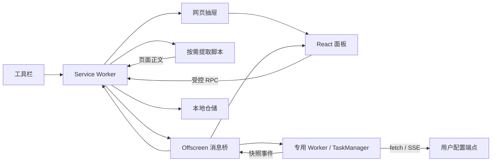

# 架构与迭代开发

## 设计目标

让扩展入口只负责浏览器上下文协调，业务规则可独立测试。供应商、站点提取器与界面不互相依赖；所有持久化写入集中在 Service Worker 中，以避免多面板同时读改写丢失数据。

```text
entrypoints/
  background.ts        浏览器入口、RPC 边界、权限检查、引擎生命周期和唯一写入协调
  drawer.content.ts    closed Shadow DOM 宿主、扩展 iframe、宽度拖动
  extract.content.ts   按需注入，一次性提取当前页面
  offscreen/           Chrome runtime 与专用 Worker 之间的消息桥
  engine-worker.ts     独立打包的扩展内 Worker 入口，开发与生产共用
  sidepanel/           抽屉、原生侧栏、独立窗口共用的 React 界面
  options/             独立设置页
components/
  chat/                聊天状态协调、消息和内容查看器
  providers/           供应商表单、导入交互
  ui/                  品牌、错误提示、对话框等基本组件
lib/
  auth/                PKCE、身份验证、授权状态机和令牌刷新
  domain/              URL 规范化、上下文预算等无浏览器依赖规则
  extraction/          Readability + Markdown、提取器注册表
  engine/              独立 Worker 和可注入依赖的 TaskManager
  llm/                 协议适配、HTTP 调用、模型列表、增量 SSE 解析
  config/              JSON / TOML 配置字段映射
  storage/             仓储与可替换的存储驱动
  platform/            UI RPC 客户端、域名权限
  ui/                  React 配置订阅
types/                 共享实体、请求、事件与响应类型
config/                默认设置、供应商预设
tests/                 有行为意义的自动化测试
scripts/               浏览器验收、图标生成、产物检查
```

## 数据与任务链路



Offscreen 使用 Chrome 的 `WORKERS` reason，确实创建独立 Worker；模型网络任务在 Worker 执行，不依赖 React 页面存活。Offscreen 仅使用 `chrome.runtime`，不会直接调用不支持的 storage API。

Worker 使用 WXT unlisted script 单独构建，通过 `chrome.runtime.getURL('/engine-worker.js')` 创建。不要使用基于 `import.meta.url` 的 Vite Worker 路径：在开发服务中它会指向 HTTP 资源，与扩展源不同，已在浏览器中复现其导致侧栏渲染进程崩溃。Worker 初始化失败会返回明确错误，不让面板持续加载。`test:e2e:dev` 使用隔离开发服务验证这条链路，CI 同时覆盖开发和生产模式。

### 身份分离

| 字段                                  | 职责                                     |
| ------------------------------------- | ---------------------------------------- |
| `pageKey`                             | 规范化网址；本地历史身份                 |
| `Conversation.id`                     | 一次提取建立的会话身份                   |
| `tabId + pageKey`                     | 运行任务隔离键                           |
| `streamId`                            | 单次生成身份；重复启动去重、停止指定任务 |
| `TaskSnapshot.startedAt` / `sequence` | 新旧任务与事件顺序判断                   |
| `Conversation.revision`               | 最近一次生成版本                         |

同一标签页的不同页面可保留各自运行任务，同网址的不同标签页也可以并行。默认不替换运行中的同页任务。停止先校验标签页与任务 ID，清理再比较任务对象，旧任务不会误删新任务。

每次开始任务先保存问题和待回答消息；成功、错误、停止均保存终态。流式事件包含累计回答，限制为约 80ms 广播一次。面板打开时并行请求缓存会话和引擎快照；不按“最近两分钟有 user 消息”等启发式推断任务存活。

后台对引擎命令和 idle 关闭使用串行队列，防止检查空闲后恰好开始的新任务被关闭。引擎快照为空闲清理前的内存状态，不是浏览器退出后的断点续传。浏览器重启时恢复已保存历史，不能继续旧网络连接。

### 存储

- `config`：schemaVersion、供应商、当前供应商 ID、设置。
- `conversation:<pageKey>`：独立记录的会话，保留最新 10 个网页。
- `drawerWidth`：抽屉宽度；通过后台读写，内容脚本不直接读取密钥所在的存储。
- `Repository` 的队列集中管理修改；失败不会使队列永久拒绝。
- API Key 未加密；本地存储设为 `TRUSTED_CONTEXTS`，不向内容脚本开放。
- 相同 URL 的跨标签页历史采用最后保存结果；如需严格独立历史，新增索引与迁移，不要只修改任务键。

当前 schema 为 1。变更存储结构时增加显式迁移，在仓储层处理旧版本；不要在 React 组件内散落兼容判断。数据规模增加后可替换 `StorageDriver` 为 IndexedDB，保留上层仓储契约。

## 新增功能的落点

### 新模型协议

在 `lib/llm/adapters.ts` 中新增适配器，定义路径、鉴权、请求体、增量解析、完整 JSON 解析和结束标记。同步扩展 `ApiFormat`、表单选项及导入映射，并在 `tests/client.test.ts` 中验证请求和异常路径。不要把供应商专属 effort 或 reasoning 参数硬塞进所有兼容接口。

预设只放地址、协议等可编辑模板。模型名称由用户填写或列表获取，不作为实时能力声明。Chat / Responses 的 Base URL 不自动补 `/v1`；Anthropic 统一处理版本段。

### 新内容来源

在 `lib/extraction/` 新建站点适配器并通过 `registry.ts` 分派，返回统一的 `PageSource`。专用脚本、权限和页面生命周期由 background 协调。YouTube / B 站需先加入真实字幕验证、超时和恢复，再解除注册表中的明确拒绝。

涉及 MAIN world 时将读取结果视为不可信输入，不从页面读取任意命令。临时网络钩子必须在 finally 恢复。视频字幕需独立的分段时间模型，不能直接把播放器导航文字当正文。

### 引用、笔记与压缩

- 引用：提取器返回可定位的片段 ID，协议提示词仅引用这些 ID；UI 定位指令通过受控后台接口发送。
- 笔记：新增独立实体和仓储，避免把用户笔记混入可重新提取覆盖的正文缓存。
- 模型压缩：在 `buildContext` 前加可替换的历史压缩服务；压缩失败仍执行最终预算判断，记录压缩元数据。

## 安全和权限边界

ChatGPT 授权由 `lib/auth/` 管理，background 只协调浏览器标签页与导航事件。固定登录标签页与精确回调 origin / port / path，并校验 state、PKCE、nonce 与 ID-token 签名；不要求 localhost 监听器。导航事件捕获回调，状态查询以 pendingUrl / url 兜底。回调的授权码先标记已消费，再交换令牌，避免重复事件复用。

`Repository(chrome.storage.local)` 独占 `chatgpt-auth:<id>` 凭证写入；`Repository(chrome.storage.session)` 保存短期登录流程与 PKCE，支持后台重启，浏览器退出后不保留未完成流程。后台重启遇到交换中的流程会要求重新登录，不重复消费授权码。配置只保存连接 ID / email；界面、任务快照和广播事件不携带令牌。过期未保存的连接会清理，已保存记录在恢复时保留。

模型列表在后台请求，Codex 目录单独附加 `client_version` 查询参数，兼容版本集中在 `config/chatgpt.ts`；普通 API Key 模型列表保持原有路径。目录失败与登录失败分别显示，保留已授权连接供重试或手动选择模型。生成仍在 offscreen 专用 Worker 中执行。Worker 经 offscreen 的专用 `glintab:auth` 通道向后台取得短期 access token 和账号 ID，后台仅接受自己的 offscreen 页面，并检查连接仍在已保存配置中。刷新令牌始终不进入 Worker。请求固定到 Codex 后端，禁用 HTTP 重定向，使用账号 header、store:false / stream:true。API Key 模式继续访问用户配置的端点。

每个连接串行执行刷新、重连与删除，401 按凭证 revision 去重并最多重试一次。刷新前先持久化失效标记，成功后原子替换整组凭证；若后台中断或新凭证保存失败，要求重新登录，避免再次使用已轮换的 refresh token。停止任务可以立即结束等待凭证的操作，共享刷新仍负责完成持久化。删除连接仅清理本地凭证，不声称已撤销远程授权。

- 没有默认全站读取权限；内容脚本的 `matches: []` 是有意选择，避免 WXT 为 runtime 内容脚本自动添加全站 host 权限。由用户点击的 `activeTab` 或显式可选站点授权注入。
- 缺少读取权限时，面板提供「一次授权所有网站」（可选 HTTP/HTTPS 通配权限）和「仅授权当前网站」。权限请求直接由用户点击发起，授予范围由浏览器保存；不改变生产 Manifest 的默认权限，也不增加自动注入。注入错误区分权限不足、受限页、页面跳转及脚本加载失败，不将所有失败误报为授权问题。
- RPC 仅接受本扩展的 sidepanel/options 页面；提取和宽度等有限通道仅接受自己的主框架内容脚本。引擎事件只接受 offscreen，任务命令只接受后台。
- 抽屉没有面向网站的 `postMessage` 控制接口，关闭操作经扩展 runtime 发回后台。
- React Markdown 不启用原始 HTML，图片仅显示描述，链接使用安全的新窗口属性。
- 正文作为不可信参考数据放入模型上下文。提示词不能保证抵抗所有模型提示注入，输出事实仍需核对原文。
- 远程端点要求 HTTPS；仅回环本机地址允许 HTTP；拒绝 URL 内联账号、密钥参数和锚点。

## 技术参考

- [WXT Entrypoints](https://wxt.dev/guide/essentials/entrypoints.html)
- [Chrome Offscreen API](https://developer.chrome.com/docs/extensions/reference/api/offscreen)
- [Chrome Side Panel API](https://developer.chrome.com/docs/extensions/reference/api/sidePanel)

构建依赖由 `package-lock.json` 锁定；使用 `npm ci` 复现。CI 使用 Node.js 22，执行类型检查、测试、构建和隔离浏览器验收。
