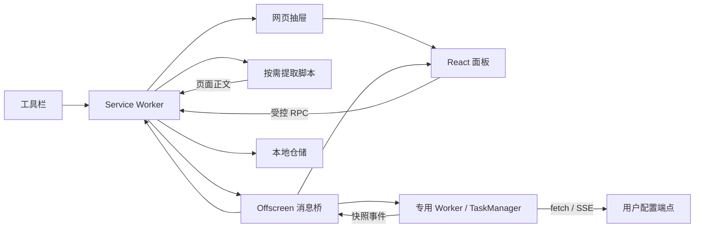

# 架构与迭代开发

## 设计目标

让扩展入口只负责浏览器上下文协调，业务规则可独立测试。供应商、站点提取器与界面不互相依赖；所有持久化写入集中在 Service Worker 中，以避免多面板同时读改写丢失数据。

```text
entrypoints/
  background.ts        浏览器入口、RPC 边界、权限检查、引擎生命周期和唯一写入协调
  drawer.content.ts    closed Shadow DOM 宿主、扩展 iframe、宽度拖动
  extract.content.ts   按需注入，一次性提取当前页面
  offscreen/           Chrome runtime 与专用 Worker 之间的消息桥
  engine-worker.ts     独立打包的扩展内 Worker 入口，开发与生产共用
  sidepanel/           抽屉、原生侧栏、独立窗口共用的 React 界面
  options/             独立设置页
components/
  chat/                聊天状态协调、消息和内容查看器
  providers/           供应商表单、导入交互
  ui/                  品牌、错误提示、对话框等基本组件
lib/
  auth/                PKCE、身份验证、授权状态机和令牌刷新
  domain/              URL 规范化、上下文预算等无浏览器依赖规则
  extraction/          Readability + Markdown、视频字幕、提取器注册表
  engine/              独立 Worker 和可注入依赖的 TaskManager
  llm/                 协议适配、HTTP 调用、模型列表、增量 SSE 解析
  config/              JSON / TOML 配置字段映射
  storage/             仓储与可替换的存储驱动
  platform/            UI RPC 客户端、域名权限
  ui/                  React 配置订阅
types/                 共享实体、请求、事件与响应类型
config/                默认设置、供应商预设
tests/                 有行为意义的自动化测试
scripts/               浏览器验收、图标生成、产物检查
```

## 数据与任务链路



Offscreen 使用 Chrome 的 `WORKERS` / `BLOBS` reason，创建独立 Worker，并在有需要时解码音频 Blob；模型网络任务在 Worker 执行，不依赖 React 页面存活。不使用会在无播放时自动关闭的 `AUDIO_PLAYBACK` reason。Offscreen 仅使用 `chrome.runtime`，不会直接调用不支持的 storage API。

Worker 使用 WXT unlisted script 单独构建，通过 `chrome.runtime.getURL('/engine-worker.js')` 创建。不要使用基于 `import.meta.url` 的 Vite Worker 路径：在开发服务中它会指向 HTTP 资源，与扩展源不同，已在浏览器中复现其导致侧栏渲染进程崩溃。Worker 初始化失败会返回明确错误，不让面板持续加载。`test:e2e:dev` 使用隔离开发服务验证这条链路，CI 同时覆盖开发和生产模式。

### 身份分离

| 字段                                  | 职责                                     |
| ------------------------------------- | ---------------------------------------- |
| `pageKey`                             | 规范化网址；本地历史身份                 |
| `Conversation.id`                     | 一次提取建立的会话身份                   |
| `tabId + pageKey`                     | 运行任务隔离键                           |
| `streamId`                            | 单次生成身份；重复启动去重、停止指定任务 |
| `TaskSnapshot.startedAt` / `sequence` | 新旧任务与事件顺序判断                   |
| `Conversation.revision`               | 最近一次生成版本                         |

同一标签页的不同页面可保留各自运行任务，同网址的不同标签页也可以并行。默认不替换运行中的同页任务。停止先校验标签页与任务 ID，清理再比较任务对象，旧任务不会误删新任务。

每次开始任务先保存问题和待回答消息；成功、错误、停止均保存终态。流式事件包含累计回答，限制为约 80ms 广播一次。面板打开时并行请求缓存会话和引擎快照；不按“最近两分钟有 user 消息”等启发式推断任务存活。

「刷新页面并摘要」通过 `page:refresh-summary / page:refresh-status / page:refresh-cancel` 交给后台 `PageRefreshManager`，仅聊天面板可调用，固定来源面板必须匹配 tabId 和显示模式。任务规则放在 `lib/engine/page-refresh.ts`，浏览器加载等待放在 `lib/platform/page-reload.ts`。开始前校验供应商和来源，在 session Repository 写入 `page-refresh:<tabId>` 保留刷新 ID、独立 streamId、pageKey、阶段及显示模式，随后检查运行任务并刷新；写入失败不刷新、不调用模型。按标签页串行受理，普通任务启动也检查刷新占位，防止多面板抢占和重复点击。

加载等待监听主标签页更新和关闭，并比较主框架新旧 documentId；只有新文档 complete 后才恢复抽屉、重新提取并启动标准摘要流程，25 秒未完成则报错。准备期间持续检查 pageKey 和 pendingUrl，跳转或关闭不使用新页面或旧提取结果；取消在提取后、启动前再次检查，启动已在途或已完成的迟到取消只停止该任务的 streamId。原面板销毁不影响后台流程，恢复后从受控状态请求、session 变更和引擎快照重连，旧流事件不能覆盖刷新状态。所有准备状态和正文持久化仍由后台仓储写入，配置和默认注入权限不变。

后台重启时，若已存在同 streamId 引擎快照则继续展示；否则把中断的准备标为失败，不自动重复刷新或计费请求。准备阶段状态写入失败时，存活后台提供失败状态供面板轮询恢复；未读取新内容前保留旧会话。清除数据前要求取消所有准备任务。页面刷新只等待浏览器文档加载完成，不能保证任意站点的后续异步数据都已加载。

后台对引擎命令和 idle 关闭使用串行队列，防止检查空闲后恰好开始的新任务被关闭。引擎快照为空闲清理前的内存状态，不是浏览器退出后的断点续传。浏览器重启时恢复已保存历史，不能继续旧网络连接。

### 存储

- `config`：schemaVersion、供应商、当前供应商 ID、设置。
- `conversation:<pageKey>`：独立记录的会话，保留最新 10 个网页。
- `drawerWidth`：抽屉宽度；通过后台读写，内容脚本不直接读取密钥所在的存储。
- `Repository` 的队列集中管理修改；失败不会使队列永久拒绝。
- API Key 未加密；本地存储设为 `TRUSTED_CONTEXTS`，不向内容脚本开放。
- 相同 URL 的跨标签页历史采用最后保存结果；如需严格独立历史，新增索引与迁移，不要只修改任务键。

当前配置 schema 为 2。`Repository.config()` 在写入队列内将 schema 1 迁移为 2：保留供应商、回答语言、网页自定义指令和内容显示设置，补上独立 `videoPrompt` 并持久化；迁移失败会报错且保留旧记录，后续可重试。配置内部读写共用 `loadConfig`，避免在队列内再次排队造成死锁。新安装读取默认值不落盘，清除数据后仍保持空存储。未来版本不静默覆盖。

变更存储结构时增加显式迁移，在仓储层处理旧版本；不要在 React 组件内散落兼容判断。数据规模增加后可替换 `StorageDriver` 为 IndexedDB，保留上层仓储契约。

摘要设置中的 `webPrompt` / `videoPrompt` 分开保存，由 `lib/domain/settings.ts` 校验非空、12,000 字符上限和设置字段；写入仍只经后台 Repository。`task:start` 在后台读取最新保存的配置，按已提取来源是否有 `video` 选择指令，覆盖摘要任务的问题后交给引擎；普通提问保留输入。UI 不决定最终指令，已打开面板无需重开即可使用新设置。自定义指令不替换系统中的来源与字幕约束，不修改已保存的旧回答。

可选 `settings.domainPrompts` 保存 `{ id, domain, prompt }` 数组，兼容 schema 2，旧配置读取时由 Repository 的默认设置补上空数组，不触发额外写入或覆盖旧指令。规则最多 50 条，指令非空且最多 12,000 字符；域名在领域层规范为小写 ASCII（支持国际化域名），拒绝 URL、路径、端口、通配符、重复域名和重复 ID。设置页只维护草稿，经既有受控 `settings:save` RPC 和 `Repository.saveSettings` 校验写入；失败保留已有配置。

摘要开始时，后台使用已校验来源标签页的实际 URL 调用领域选择函数，按完整 hostname 标签匹配自身及子域，最长匹配域名优先；命中后替代通用网页或视频摘要指令，否则按来源类型回退。只有选定的指令作为问题进入模型请求。配置修改仅影响下一次摘要，运行中的任务继续使用启动时的问题与设置快照；不改变任务身份、事件序号、停止、重连或持久化路径。

## 新增功能的落点

### 新模型协议

在 `lib/llm/adapters.ts` 中新增适配器，定义路径、鉴权、请求体、增量解析、完整 JSON 解析和结束标记。同步扩展 `ApiFormat`、表单选项及导入映射，并在 `tests/client.test.ts` 中验证请求和异常路径。不要把供应商专属 effort 或 reasoning 参数硬塞进所有兼容接口。

预设只放地址、协议等可编辑模板。模型名称由用户填写或列表获取，不作为实时能力声明。Chat / Responses 的 Base URL 不自动补 `/v1`；Anthropic 统一处理版本段。

API Key 供应商的可选 `stream` 字段控制请求中的 `stream`：旧记录未设置时等价于 `true`，明确关闭时使用 `false`，现有完整 JSON 解析路径一次返回文本。该字段为向后兼容的可选能力，不改变配置 schema 2，也不按模型名称硬编码协议切换；由用户根据服务商要求配置。ChatGPT 账号连接仍固定 `store:false / stream:true`。

供应商可选 `reasoningEffort` 由 `lib/domain/reasoning.ts` 校验枚举，未设置时省略请求参数，兼容旧配置且无需 schema 迁移。后台保存与任务启动均校验；协议层再次校验并映射：Chat Completions 使用 `reasoning_effort`，Responses / ChatGPT 账号使用 `reasoning.effort`，Anthropic 不发送这些字段。表单切换到 Anthropic 时清除该设置。字段仍经后台 Repository 保存，任务使用启动时的供应商快照，配置编辑不干扰并发任务、停止和凭证刷新；401 重试保留原请求参数。支持档位由用户按服务商确认，不按模型名称推测；不自动降档或重试被服务商拒绝的请求。参数依据 [OpenAI 官方推理文档](https://developers.openai.com/api/docs/guides/reasoning)。

HTTP 400 错误正文最多读取 16,000 字节，1.5 秒后取消读取；仅将白名单参数名转成固定中文提示，不透传错误消息、未知参数或响应原文。无法解析时使用状态码提示，其他 HTTP 失败不读取正文并取消响应流。错误提示沿现有任务快照传播，失败任务仍保存终态并恢复输入，不自动更换模型或重试可能计费的请求。

### 新内容来源

在 `lib/extraction/` 新建站点适配器并通过 `registry.ts` 分派，返回统一的 `PageSource`。专用脚本、权限和页面生命周期由 background 协调。视频地址识别和时间戳规则放在 `lib/domain/video.ts`；普通页面仍使用 Readability。

普通网页在脱离原页面的 clone 上先规范链接，再交给 Readability，避免相对链接受中间文档 base URL 影响。链接完整保留查询参数及空值；无文字的图片链接使用已有 `aria-label / title / alt`，缺省使用「查看原文」，避免产生空标题 Markdown 链接。提取正文和回退路径共用规范结果，不修改现场 DOM、不下载封面图。上下文指令要求原样引用来源 URL、保留全部参数，不根据 ID 造链接；回答渲染剥离内部 AST `node` 属性，继续禁用原始 HTML 并保留安全的新窗口属性。提示词约束不能保证任意模型都遵守，实际来源可在正文查看器中核对。

YouTube / B 站由 background 按需使用 `scripting.executeScript({ world: 'MAIN' })` 执行自包含的 `readVideoPage`，通过 Chrome 注入结果直接返回，不增加页面可调用的 runtime / postMessage 桥。函数不依赖外部运行时变量，不携带扩展配置或密钥，不安装网络钩子，不修改播放器状态。页面输出一律不可信，后台 `videoSource` 重新校验视频身份、分 P、格式、有限时间值和长度，再构造 `PageSource.video` 的分段时间模型及正文中的时间戳链接。新字段可选，已有会话无需迁移。

YouTube 校验当前播放器响应的 videoId，选择轨道并读取 JSON3 或 XML；可复用当前视频、当前语言已请求的播放器字幕 URL。B 站重新请求 URL 对应的视频元信息，按 `p` 选择 cid，再访问 `/x/player/wbi/v2` 和受限的字幕 CDN 域名，不依赖可能滞后的 SPA 初始状态。此接口可能受登录、签名策略或风控影响，失败时明确提示，不降级为旧接口、弹幕或导航正文。

页面请求沿用站点凭证，字幕 CDN 请求不携带凭证；不直接读取 Cookie。请求禁止重定向，总计 12 秒超时并中止 fetch，响应上限 4 MB；后台 15 秒兜底释放提取锁。每标签页只允许一次提取，视频结果绑定当前调用而不是共享的结果事件；后台返回前再次读取标签页 URL 和待导航地址，拒绝切页结果。旧调用的清理先比较 token，避免误删新锁，超时后可重新提取。字幕在完整片段边界截断至 120,000 字符，缓存只保留已纳入正文的分段，不保存带签名的字幕下载地址。

自动测试覆盖模拟 JSON3 / XML / B 站字幕的解析、无字幕、登录限制、超时恢复、切页、分 P、下载域名和上下文预算，并在真实扩展中验证 MAIN → background → Worker 链路。真实站点验证状态单独记录在 `ACCEPTANCE.md`，不可将模拟通过解释为真实账号或全站视频验收。

涉及 MAIN world 时将读取结果视为不可信输入，不从页面读取任意命令。临时网络钩子必须在 finally 恢复。视频字幕需独立的分段时间模型，不能直接把播放器导航文字当正文。

### B 站音轨转写

配置中的可选 `transcription` 独立保存 `enabled / baseUrl / apiKey / model / responseFormat`，缺省时禁用，兼容 schema 2，无需迁移；由 `lib/domain/transcription.ts` 校验，经后台 `Repository.updateConfig` 写入。表单直接在用户点击时申请转写服务和受限 B 站音频 CDN 的可选 host 权限。密钥不进入 MAIN、任务快照、事件和会话；配置编辑对已启动任务不追溯生效。

`readVideoPage` 仅在 B 站字幕列表为空且不要求登录时返回 `bilibili-audio-required`，`videoSource` 构造空正文和 `video.transcription:'required'` 标记。`task:start` 校验当前 B 站页面和已启用的配置，将转写配置作为独立任务输入。TaskManager 在调用模型前执行可注入的准备步骤，先持久化任务，再发布进度，最终拿到正文后进入已有预算/生成流程。准备与转写最多 20 分钟，模型阶段重新计时 5 分钟；`tabId + pageKey / streamId / sequence` 继续负责隔离、去重和过滤旧事件。完成的转写先单独持久化，避免总结失败后丢失转写；初始保存失败不发起下载或付费转写。

Worker 通过 offscreen 的 `glintab:audio` 专用消息向 background 申请音轨元数据，后台仅接受自身 offscreen，并确认引擎中的任务仍在运行、streamId 与页面匹配。`lib/extraction/bilibili-audio.ts` 在 MAIN 中重新读取 URL 对应的视频与分 P 信息，再请求播放接口；禁止重定向，12 秒中止 fetch，后台 15 秒兜底。仅使用完整、非受保护、非试看、60 分钟以内的 AAC 音轨，从主备地址中选择受限 HTTPS CDN，剔除第三方 PCDN 和非标准端口。MAIN 结果不可信，后台重新校验身份、cid、时长与 URL。返回前再次检查当前标签页与任务，旧调用不能向新任务交付地址。

`declarativeNetRequestWithHostAccess` 仅设置一个 session 规则：initiator 为本扩展、目标为 `bilivideo.com / bilivideo.cn` 的 XHR 请求才附加固定 B 站 Referer；不修改网页请求，不读取其请求内容，禁用转写或清空数据时移除规则。音轨 URL 只在后台到 offscreen 的私有响应中出现，不进入持久化或广播。

`lib/engine/audio.ts` 在 offscreen 中以 `credentials:omit / redirect:error` 下载，限制 64 MB，并在解码前校验媒体容器时长。浏览器解码为 16 kHz PCM，最多 5 分钟分一段，生成独立合法的单声道 WAV，经 transferable 交给 Worker；不是切割压缩字节，不需要录音或播放视频。offscreen 同时只准备一个音轨，避免多个解码器占用过多内存。转写参数由 `lib/llm/transcription.ts` 以 multipart 上传，默认不自动重试计费请求；仅有限读取 JSON，错误不回显原始响应。有真实分段时间戳才平移片段偏移并生成链接，否则保存纯文本并使用 `timestamps:false` 明确禁止虚构时间戳。

取消会同时中止音轨 fetch 和转写 fetch，Worker 立即结束等待解码的操作，原生解码完成后释放资源，旧响应按独立请求 ID 忽略。正在转写时切换 URL 或关闭源标签页也会停止；后台通过存活引擎查询任务并重新读取标签页 URL，不依赖 Service Worker 内存索引，后台休眠重启后仍能处理切页，旧导航事件不会停止绑定新 URL 的任务。转写完成后的总结按原有独立任务行为运行。关闭面板后继续，重开从引擎快照恢复进度；浏览器退出不支持音频断点续传，未完成的分段文字不落盘，重试会重新计费。原音频与签名 URL 不保存，只有规范化来源、转写标记和最终文字/实际时间片段进入 Repository。

### 引用、笔记与压缩

- 引用：提取器返回可定位的片段 ID，协议提示词仅引用这些 ID；UI 定位指令通过受控后台接口发送。
- 笔记：新增独立实体和仓储，避免把用户笔记混入可重新提取覆盖的正文缓存。
- 模型压缩：在 `buildContext` 前加可替换的历史压缩服务；压缩失败仍执行最终预算判断，记录压缩元数据。

## 安全和权限边界

设置页「支持作者」由 `components/settings/SupportAuthor.tsx` 展示包内 `assets/support-qr.jpg`，使用发布者提供的收款码原图。图片按原样打包，不解码二维码、不自动访问付款地址；查看原图和保存图片通过普通本地资源链接完成。此入口不写存储、不新增 RPC 或权限，不集成支付 SDK、订单状态或功能解锁逻辑。

ChatGPT 授权由 `lib/auth/` 管理，background 只协调浏览器标签页与导航事件。固定登录标签页与精确回调 origin / port / path，并校验 state、PKCE、nonce 与 ID-token 签名；不要求 localhost 监听器。导航事件捕获回调，状态查询以 pendingUrl / url 兜底。回调的授权码先标记已消费，再交换令牌，避免重复事件复用。

`Repository(chrome.storage.local)` 独占 `chatgpt-auth:<id>` 凭证写入；`Repository(chrome.storage.session)` 保存短期登录流程与 PKCE，支持后台重启，浏览器退出后不保留未完成流程。后台重启遇到交换中的流程会要求重新登录，不重复消费授权码。配置只保存连接 ID / email；常规界面响应、任务快照和广播事件不携带令牌。过期未保存的连接会清理，已保存记录在恢复时保留。

设置页的专用 `chatgpt:auth:get` 是完整凭证读取的显式例外，侧栏、offscreen 和内容脚本均不可调用。请求需匹配已保存连接，或提供有效登录草稿的 `draftKey`。响应只在编辑组件的内存中保存，含 JSON 表示及独立的仓储 revision；普通 `config:get`、登录状态、会话和广播仍不含令牌。

`lib/domain/auth-json.ts` 校验 128,000 字符上限和必要字段，丢弃未知字段；`ChatGPTOAuth.importAuthJson` 校验缓存 ID token 的签名、issuer、audience、subject 和导入凭证内部的账号一致性，JWT 访问令牌的 `exp` 优先于扩展附加的 `expires_at`。`provider:save` 的可选 `authJson / authRevision / replaceAuth` 仅允许设置页提交，后台校验固定协议和域名权限，沿连接锁与刷新、重连、删除串行化。直接编辑仍检查 revision 且不能原样恢复本地已失效的刷新令牌；粘贴按钮和原生 paste 事件标记显式替换，允许切换账号、覆盖期间刷新的凭证，并在新记录中清除旧失效状态。

显式替换分配新的 connectionId，保留供应商 ID、当前选中状态和模型配置，更新已验证的账号信息；仓储在同一次写入中提交凭证和配置，检查供应商仍绑定待替换连接，避免重建已删除或覆盖其他窗口新绑定的连接。成功后只清理不再被供应商引用的旧凭证，共享旧连接的其他供应商保留。旧任务继续绑定原 connectionId；原连接已无配置引用时，后续凭证请求被拒绝，不会改用新账号。写入失败保留旧记录，不保存 JSON 原文。粘贴仍仅在用户点击「保存连接」时提交。

模型列表在后台请求，Codex 目录单独附加 `client_version` 查询参数，兼容版本集中在 `config/chatgpt.ts`；普通 API Key 模型列表保持原有路径。目录失败与登录失败分别显示，保留已授权连接供重试或手动选择模型。生成仍在 offscreen 专用 Worker 中执行。Worker 经 offscreen 的专用 `glintab:auth` 通道向后台取得短期 access token 和账号 ID，后台仅接受自己的 offscreen 页面，并检查连接仍在已保存配置中。刷新令牌始终不进入 Worker。请求固定到 Codex 后端，禁用 HTTP 重定向，使用账号 header、store:false / stream:true。API Key 模式继续访问用户配置的端点。

每个连接串行执行刷新、重连与删除，401 按凭证 revision 去重并最多重试一次。刷新前先持久化失效标记，成功后原子替换整组凭证；若后台中断或新凭证保存失败，要求重新登录，避免再次使用已轮换的 refresh token。停止任务可以立即结束等待凭证的操作，共享刷新仍负责完成持久化。删除连接仅清理本地凭证，不声称已撤销远程授权。

- 没有默认全站读取权限；内容脚本的 `matches: []` 是有意选择，避免 WXT 为 runtime 内容脚本自动添加全站 host 权限。由用户点击的 `activeTab` 或显式可选站点授权注入。
- 缺少读取权限时，面板提供「一次授权所有网站」（可选 HTTP/HTTPS 通配权限）和「仅授权当前网站」。权限请求直接由用户点击发起，授予范围由浏览器保存；不改变生产 Manifest 的默认权限，也不增加自动注入。注入错误区分权限不足、受限页、页面跳转及脚本加载失败，不将所有失败误报为授权问题。
- RPC 仅接受本扩展的 sidepanel/options 页面；提取和宽度等有限通道仅接受自己的主框架内容脚本。引擎事件只接受 offscreen，任务命令只接受后台。
- 抽屉没有面向网站的 `postMessage` 控制接口，关闭操作经扩展 runtime 发回后台。
- React Markdown 不启用原始 HTML，图片仅显示描述，链接使用安全的新窗口属性。
- 正文作为不可信参考数据放入模型上下文。提示词不能保证抵抗所有模型提示注入，输出事实仍需核对原文。
- 远程端点要求 HTTPS；仅回环本机地址允许 HTTP；拒绝 URL 内联账号、密钥参数和锚点。

## 技术参考

- [WXT Entrypoints](https://wxt.dev/guide/essentials/entrypoints.html)
- [Chrome Offscreen API](https://developer.chrome.com/docs/extensions/reference/api/offscreen)
- [Chrome Side Panel API](https://developer.chrome.com/docs/extensions/reference/api/sidePanel)

构建依赖由 `package-lock.json` 锁定；使用 `npm ci` 复现。CI 使用 Node.js 22，执行类型检查、测试、构建和隔离浏览器验收。

发布材料由 `scripts/prepare-release.mjs` 在开发环境生成，入口为 `npm run release:materials`，不会进入扩展运行时。它使用已有生产构建的临时副本、隔离浏览器配置和仅监听回环地址的固定演示服务截取实际界面；临时 host 权限不回写生产 Manifest，设置保存仍经过产品后台 Repository。隐私政策 HTML 从 `docs/PRIVACY.md` 生成，发布者字段由 `docs/release/publisher.json` 核对；公开托管地址未配置时保留为空，不虚构外部站点。`release:demo` 仅提供本机演示，不是产品依赖或登录组件。
